# Change Orchestrator

```mermaid
---
config:
  layout: elk
---
flowchart TB
    request --> prepare_change
    prepare_change(Prepare change) --> refinement
    

    subgraph planning [Change planning]
        subgraph refinement [Refinement]
            plan_product_change(Plan product change)
            plan_change_design(Design change solution)
            refine_slicing(Refine slicing)
            requirements_probes(Requirements probes)
            solution_probes(Solution probes)

            plan_product_change -.- refine_slicing
            plan_change_design -.- refine_slicing
            plan_product_change -.- plan_change_design

            plan_product_change <--> requirements_probes
            plan_change_design <--> solution_probes
        end

        steer_planning(Review, steer and approve)
        steer_planning --> refinement
        refinement -->|propose| steer_planning
        refinement -->|escalate| steer_planning
    end
    refinement -->|"for each review wave\nwith all slices done"| test_wave
    steer_planning -->|withdraw| closed
    
    execute_slice(Execute slice) <-->|concurrent\nfor each\nready slice| refinement

    subgraph wave_reviewing [Review wave]
        test_wave(Test wave) --> review_wave
        review_wave(Review wave) --> assess_change
        assess_change(Assess wave)
    end
    review_wave -->|invalid| refinement
    assess_change -->|final wave\napproved| closed
    assess_change --> refinement


    class steer_planning,assess_change requester
    class prepare_change,plan_product_change,plan_change_design,refine_slicing,review_wave primary_agent
    class test_wave,requirements_probes,solution_probes sub_agent
    class planning,execute_slice,wave_reviewing collaborative_step
    class refinement autonomous_step
    class requirements_probes,solution_probes,execute_slice subprocess

    classDef requester fill:#301B22,stroke:#B83A48,stroke-width:4px
    classDef primary_agent fill:#352719,stroke:#FF850A,stroke-width:3px
    classDef sub_agent fill:#1B3029,stroke:#2D936C,stroke-width:2px
    classDef collaborative_step fill:#261D16,stroke:#C99052
    classDef autonomous_step fill:#17251F,stroke:#68A88D
    classDef subprocess stroke-width:4px,stroke-dasharray:7 4
    
```



## Context
```
reference: Input. Issue id or similar
change-dir: docs/<project>/change/<reference>-<short-title-slug>/
```

## Refinement

### Goal

Decompose a planned product change into small, coherent slices with clear dependencies and meaningful review waves.
Maintain a living overview plan in `<change-dir>/slices.md` that supports incremental refinement and dependency-driven execution without requiring detailed implementation design upfront.
Maintain living individual slice plans in `<change-dir>/<slice-slug>/slice.md`

### Process

Change planning combines product planning, solution design, and slicing as interdependent thinking focuses of the primary agent—not sequential stages. Move among them as new information requires. Refinement is autonomous between requester interactions; use **Review, steer and approve** for feedback and decisions. A question to the requester ends the current turn.

### Product planning

Establish and elaborate requirements, rules, constraints, and expected outcomes for users, stakeholders, and systems, internal or external. Actor stories are one useful format, not a requirement. Elaborate slice-level requirements as slicing exposes gaps.

### Solution design

Explore viable approaches and establish the architectural direction needed for successful delivery. Address architectural constraints, cross-slice dependencies and mitigations, validation approaches, and uncertainties or risks that could make slice execution fail. Reduce that risk without prescribing detailed slice designs.

### Slicing

Apply **divide and conquer** to turn requirements and architectural direction into small, coherent units of work. Each slice covers a narrowly defined piece of functionality in one area of concern and can be implemented, tested, and committed as a unit. Split work that can proceed independently; combine it when separation adds more overhead than value.

The decomposition is iterative: resolving one part may clarify, constrain, or make possible the definition of another. Refine incrementally, focusing on unblocked or approaching work and deriving necessary enabling slices. Record a dependency only when its prerequisite must be completed and committed; keep independent work independent. Define outcomes, boundaries, and completion expectations—not implementation steps. Feed newly exposed requirements, design questions, dependencies, or uncertainty back into the relevant planning focus.

### Probe boundaries

Probes are bounded, delegated activities supporting product planning or solution design—not separate thinking focuses. Use them on demand for isolated investigation or candidate artifacts. Classify a probe by its mandate, not by the artifact it produces or the system boundary it examines.

Requirements probes gather evidence about existing requirements and constraints; they do not establish or change them. Solution probes investigate approaches and may propose candidate designs, including designs that raise product or requirement questions; they cannot decide requirements or make binding product decisions. The primary agent evaluates and integrates results in the appropriate planning focus. Probes do not modify the product; experiments belong in spike slices.

## Artifacts & invariants

- `<change-dir>/change.md`: change description and agreed whole-change human testing and review attention points.
- `<change-dir>/slices.md`: living slice overview, dependency map, horizon, and review-wave plan.
- `<change-dir>/<slice-slug>/slice.md`: individual slice scope, state, dependencies, and completion expectations.

### Slice

The individual slice document is the canonical record of that slice’s scope, state, dependencies, and expected outcome.

### Horizon

The horizon holds work whose boundaries or dependencies are not understood well enough to define slices. Refine what is understood; use solution design or a probe to resolve questions, and an exploratory slice when evidence requires project changes. Do not treat horizon items as executable slices.

### Review waves

Group slices into meaningful product-validation outcomes. Waves may overlap and span areas of concern; they are independent of execution scheduling and reviewable when their required slices are complete. Assess each wave with the requester: findings or further work return to refinement; approval of the final wave closes the change. Keep the agreed whole-change human testing and review attention points in `change.md`.

Keep plans current and remove superseded notes.


## Orchestrate slice execution

```mermaid
flowchart TB
    input --> plan_slice_design

    subgraph slice_design [Change solution design]
        plan_slice_design(Plan slice solution) --> review_slice_design
        update_driving_test(Update test)
        review_slice_design(Review & Refine) --> |steer| plan_slice_design
        review_slice_design --> reject
    end
    review_slice_design --> implement
    
    implement(Implement) --> test_slice
    implement --> |fail| plan_slice_design
    
    test_slice(Test slice) --> assess_slice
    test_slice --> |reject| plan_slice_design
    assess_slice(Assess slice)
    assess_slice --> reject
    
    class , requester

    classDef requester fill:#301B22,stroke:#B83A48,stroke-width:4px
    classDef primary_agent fill:#352719,stroke:#FF850A,stroke-width:3px
    classDef sub_agent fill:#1B3029,stroke:#2D936C,stroke-width:2px
    classDef collaborative_step fill:#261D16,stroke:#C99052
    classDef autonomous_step fill:#17251F,stroke:#68A88D
    classDef subprocess stroke-width:4px,stroke-dasharray:7 4
```

A slice is ready when it is refined, approved, and its dependencies are resolved. Execute each ready slice according to capacity and execution policy; complete and commit prerequisites before dependent slices begin. Detailed slice design belongs here, within the architectural direction from refinement.



## Other steps
- Prepare change: Create `<change-dir>/change.md` skeleton from initial request

This process is WIP. For other undefined steps, clarify with the requester how to handle.
