# Change Orchestrator

```mermaid
---
config:
  layout: elk
---
flowchart TB
    request --> prepare_change
    prepare_change(Prepare change) --> refinement
    

    subgraph planning [Change planning]
        subgraph refinement [Refinement]
            plan_product_change(Plan product change)
            plan_change_design(Design change solution)
            refine_slicing(Refine slicing)
            requirements_probes(Requirements probes)
            solution_probes(Solution probes)

            plan_product_change -.- refine_slicing
            plan_change_design -.- refine_slicing
            plan_product_change -.- plan_change_design

            plan_product_change <--> requirements_probes
            plan_change_design <--> solution_probes
        end

        steer_planning(Review, steer and approve)
        steer_planning --> refinement
        refinement -->|propose| steer_planning
        refinement -->|escalate| steer_planning
    end
    refinement -->|"for each review wave\nwith all slices done"| test_wave
    steer_planning -->|withdraw| closed
    
    execute_slice(Execute slice) <-->|concurrent\nfor each\nready slice| refinement

    subgraph wave_reviewing [Review wave]
        test_wave(Test wave) --> review_wave
        review_wave(Review wave) --> assess_change
        assess_change(Assess wave)
    end
    review_wave -->|invalid| refinement
    assess_change -->|final wave\napproved| closed
    assess_change --> refinement


    class steer_planning,assess_change requester
    class prepare_change,plan_product_change,plan_change_design,refine_slicing,review_wave primary_agent
    class test_wave,requirements_probes,solution_probes sub_agent
    class planning,execute_slice,wave_reviewing collaborative_step
    class refinement autonomous_step
    class requirements_probes,solution_probes,execute_slice subprocess

    classDef requester fill:#301B22,stroke:#B83A48,stroke-width:4px
    classDef primary_agent fill:#352719,stroke:#FF850A,stroke-width:3px
    classDef sub_agent fill:#1B3029,stroke:#2D936C,stroke-width:2px
    classDef collaborative_step fill:#261D16,stroke:#C99052
    classDef autonomous_step fill:#17251F,stroke:#68A88D
    classDef subprocess stroke-width:4px,stroke-dasharray:7 4
    
```



## Context
```
reference: Input. Issue id or similar
change-dir: docs/<project>/change/<reference>-<short-title-slug>/
```

## Templates
Check for and use up-to-date templates from `docs/harness/change/` for all documents, whenever you create new documents.

## Refinement

### Goal

Decompose a planned product change into small, coherent slices with clear dependencies and meaningful review waves.
Maintain a living overview plan in `<change-dir>/slices.md` that supports incremental refinement and dependency-driven execution without requiring detailed implementation design upfront.
Maintain individ

### Rules

- Scope each slice to one area of concern and a coherent, narrowly defined piece of functionality.
- Split work that can be implemented independently; combine work when separation adds overhead without material benefit.
- Define each slice so it can be implemented, tested, and committed as a unit.
- Record dependencies whenever a slice requires another slice to be completed and committed before it begins. Do not introduce artificial dependencies.
- Specify outcomes, boundaries, and constraints without prescribing detailed implementation design.
- Refine slices incrementally. Keep work with unresolved boundaries or dependencies in the horizon.
- Update the slice plan when new information invalidates existing assumptions, boundaries, or dependencies.
- Include only current state and constraints in the slice plan; remove and outdated, replaced, historic notes

### Workflow

Split or combine work pragmatically to balance scope, independence, and coordination overhead.

Identify prerequisites and represent them in the slice graph. Keep independent work independent.

For unresolved questions:
- Refine slice boundaries and dependencies where possible.
- Run the slice plan through change solution design for architectural decisions, cross-slice constraints, dependency mitigation and validation
- Introduce exploratory slices for questions requiring concrete work or evidence.
- Keep insufficiently understood work in the horizon.

### 3. Define review waves

Group slices into meaningful outcomes for product-level validation.

Review waves are independent of execution scheduling, may overlap, and can span multiple areas of concern. Each has a review purpose and becomes reviewable once its required slices are completed.

### 4. Refine upcoming slices

Prioritize slices whose prerequisites are satisfied or approaching completion.

Define their intended outcome, scope, constraints, dependencies, and completion expectations. Leave detailed technical design to slice execution.

### 5. Maintain the plan

Update slices, dependencies, refinement states, horizon, and review waves as implementation and reviews reveal new information.

## Execution boundary

Slicing defines **what work exists and how it relates**. Execution selects eligible slices based on dependencies, refinement state, capacity, and execution policy.

## Outputs

- Living slice map with dependencies and refinement states.
- Refined slice plans for upcoming work.
- Horizon for unresolved work.
- Review waves with meaningful validation outcomes.


## Orchestrate slice execution

```mermaid
flowchart TB
    input --> plan_slice_design

    subgraph slice_design [Change solution design]
        plan_slice_design(Plan slice solution) --> review_slice_design
        update_driving_test(Update test)
        review_slice_design(Review & Refine) --> |steer| plan_slice_design
        review_slice_design --> reject
    end
    review_slice_design --> implement
    
    implement(Implement) --> test_slice
    implement --> |fail| plan_slice_design
    
    test_slice(Test slice) --> assess_slice
    test_slice --> |reject| plan_slice_design
    assess_slice(Assess slice)
    assess_slice --> reject
    
    class , requester

    classDef requester fill:#301B22,stroke:#B83A48,stroke-width:4px
    classDef primary_agent fill:#352719,stroke:#FF850A,stroke-width:3px
    classDef sub_agent fill:#1B3029,stroke:#2D936C,stroke-width:2px
    classDef collaborative_step fill:#261D16,stroke:#C99052
    classDef autonomous_step fill:#17251F,stroke:#68A88D
    classDef subprocess stroke-width:4px,stroke-dasharray:7 4
```



## Other steps
- Prepare change: Create `<change-dir>/change.md` skeleton from initial request

This process is WIP. For other undefined steps, clarify with the requester how to handle.