# Agent Workflow Definitions

```mermaid
---
config:
    layout: elk
---
flowchart TB
    request:::state --> prepare
    prepare(Prepare task):::current_agent --> mix
    prepare -->|escalate\nmissing ingredients| buy_ingredients
    prepare --> clarify
    
    clarify(Clarify):::approval_gate --> prepare
    
    buy_ingredients(Buy ingredients):::handoff_agent_flow --> mix
    
    subgraph baking [Baking]
        mix(Mix):::subagent_process --> pour
        pour(Pour):::current_agent --> bake
        bake(Bake):::subagent_utility
    end
    class baking current_agent_steps
    bake --> check
    
    check(Check):::leader_approval_gate --> deliver
    
    deliver(Deliver cake):::handoff_agent_flow --> done
    
    done:::state

    classDef current_agent fill:#30243B,stroke:#A78BCA,stroke-width:2px
    classDef subagent_process fill:#1E2D3C,stroke:#6495C4,stroke-width:4px,stroke-dasharray:7 4
    classDef subagent_utility fill:#1B3029,stroke:#2D936C
    classDef leader_approval_gate fill:#301B22,stroke:#B83A48
    classDef handoff_agent_flow fill:#301B22,stroke:#B83A48,stroke-width:4px,stroke-dasharray:7 4
    classDef approval_gate fill:#352719,stroke:#FF850A,stroke-width:2px
    
    classDef sub_agent_steps fill:#17251F,stroke:#68A88D
    classDef leader_owned_steps fill:#26191D,stroke:#C47780x
    classDef current_agent_steps fill:#251D2D,stroke:#B6A0D0,stroke-width:2px
```

## Graph rules
Declare each subgraph's class immediately after its `end`.
Define each node on its own line with its name and class, optionally followed by its default transition.
On the right side of a transition, use only the destination node ID. Never declare a node class there.

Omit label for default happy path, or if the target node clearly labels the case, why it is reached.
These flows are not complete state machines. A valid transition MAY lead through another activity as no-op.
