<!--
Describe the slices and their dependencies for the sibling `./objective.md`.
Keep the whole document **progress-focused**. Omit context and detail that do
not help the reader understand, act on, decide, or challenge the work.
The diagram below is illustrative: replace its fictional slices, links, waves,
and dependencies with those of the objective. Retain relevant state styling.
Drop subsections without material content; add them as they become relevant.
-->
# Slicing

```mermaid
flowchart TB
    %% Slice overview
    design-draft("Design Draft"):::done
    click design-draft "./slice/_slice-slug/slice.md" "Open slice"
    api-contracts("Api contract"):::done
    click api-contracts "./slice/_slice-slug/slice.md" "Open slice"
    frontend("Frontend"):::done
    click frontend "./slice/_slice-slug/slice.md" "Open slice"
    endpoint("Endpoint"):::executing
    click endpoint "./slice/_slice-slug/slice.md" "Open slice"
    styling("Styling"):::refined
    click styling "./slice/_slice-slug/slice.md" "Open slice"
    some-slice6("Slice 6"):::refined
    click some-slice6 "./slice/_slice-slug/slice.md" "Open slice"
    permissions("Permissions"):::blurry
    click permissions "./slice/_slice-slug/slice.md" "Open slice"
    deletion("Deletion"):::refined
    click deletion "./slice/_slice-slug/slice.md" "Open slice"
    
    %% Slice dependencies
    design-draft --> frontend & styling
    api-contracts --> endpoint
    frontend --> styling
    endpoint --> permissions
    styling --> some-slice6

    %% Wave overview
    wave1
    class wave1 done_wave
    wave2
    class wave2 in_review_wave
    wave3
    class wave3 blurry_wave
    wave4
    class wave4 refined_wave
    wave5
    class wave5 blurry_wave

    %% Wave content
    subgraph wave1["wave1"]
        direction LR
        design-draft
        api-contracts
    end
    
    subgraph wave4["wave4"]
        subgraph wave2["wave2"]
            direction LR
            frontend
        end

        subgraph wave3["wave3"]
            direction LR
            styling
            endpoint
            permissions
        end
    end

    subgraph wave5["wave5"]
        direction LR
        some-slice6
    end
    
    %% final wave all above plus %%
    deletion

    %% slice states %%
    classDef blurry fill:#301B22,stroke:#B83A48,stroke-width:3px
    classDef refined fill:#1A1A1A,stroke:#777D89,stroke-width:3px
    classDef executing fill:#352719,stroke:#FF850A,stroke-width:3px
    classDef done fill:#1B3029,stroke:#2D936C,stroke-width:3px
    classDef escalated fill:#301B22,stroke:#B83A48,stroke-width:3px
    
    %% wave states %%
    classDef blurry_wave fill:#26191D,stroke:#C47780
    classDef refined_wave fill:#111111,stroke:#92969E,stroke-width:2px
    classDef done_wave fill:#17251F,stroke:#68A88D
    classDef in_review_wave fill:#261D16,stroke:#C99052
    class horizon blurry_wave
```

<!-- ⚠️ Human attention needed; use it alone for pending review, even if the
slice is done. ✅ Done with no attention needed. Otherwise leave unmarked.
Red is reserved for escalation. Do not include a visible legend.
Replace the sample status list below with the objective's actual slice statuses. -->
- ✅ Design Draft
- ⚠️ Frontend — material review pending
- Endpoint

## Wave {wave name}
### Review
<!-- List additional verification steps and areas to focus on during review. -->
### Open topics
<!-- List unresolved topics for this wave until they are addressed. -->

## Horizon
<!-- Describe relevant work beyond the current waves, if any. -->
